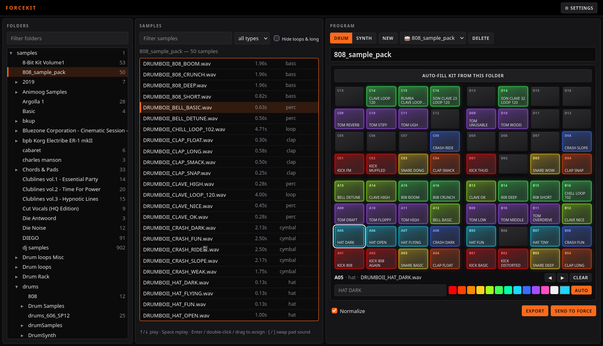
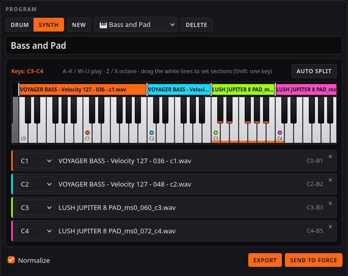
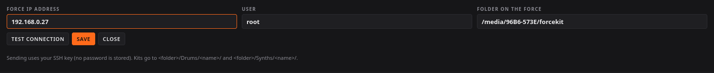

# forcekit

[](https://github.com/smarbos/forceKitMaker/actions/workflows/tests.yml)

Build **Akai Force** drum kits and keygroup synths from your own sample library, in the browser, then send them straight to the Force.

forcekit is a small local app: a Python server that indexes your samples and a web page where you browse, preview, and arrange them. Exports are real Force programs (`.xpm` plus their samples) that load like programs saved on the device.



## What it does

**Browse the library**
- Scans a sample folder (tested with ~56,000 files) and remembers each file's length, format, and a guessed sound type (kick, snare, hat, bass, pad…).
- Preview with the arrow keys, filter by name or type, and hide loops and long files.
- Broken files are crossed out, and duplicates are marked.

**Drum kits**
- The grid matches the Force: 8×8 pads, with bank A bottom-left, B bottom-right, C top-left and D top-right.
- **Auto-fill:** one click turns the open folder (including subfolders) into a kit with a fixed layout (kicks, snares, claps, hats, cymbals, toms, percussion, FX, vocals), repeated across all four banks.
- Pads are **colored by sound type**, and the colors show on the Force's pads too. Any pad can get its own color and name.
- Pad names are shortened automatically (`DRUMBOII_KICK_808.wav` → `KICK 808`).
- `[` / `]` swaps a pad for the previous or next sound of the same type, so you can pick by ear.

**Synths (keygroup programs)**



- Each sample gets a root note, read from the filename or detected from the audio, and plays pitched across its range, like a piano.
- **On-screen keyboard:** play the synth the way the Force will, with the mouse or your computer keyboard.
- **Sections:** drag the split lines to choose which part of the keyboard each sample covers, for example two octaves of bass and two octaves of pad. Or let forcekit split automatically halfway between root notes.

**Export and Send to Force**
- **Export** writes the program to a folder on your computer.
- **Send to Force** copies it to the Force over your network (SSH), into its own folder on the Force's drive.
- Samples are converted to 16-bit WAV and normalized to −1 dBFS (optional). A synth's samples share one gain, so their relative levels are kept.
- Start and end points are detected, so pads play the whole sample.
- Each program gets its own folder, with its samples in a subfolder:

  ```
  Drums/
    My Kit/
      My Kit.xpm
      My Kit_[ProgramData]/
        KICK 808.wav
        ...
  Synths/
    Bass and Pad/
      Bass and Pad.xpm
      Bass and Pad_[ProgramData]/
  ```

**Your sample library is never modified.** forcekit only reads it, and writes only to its own data folder, its export folder, and its folder on the Force.

## Requirements

- Linux, macOS or Windows, with Python 3.11 or newer.
- Optional: [ffmpeg](https://ffmpeg.org/download.html), only for unusual files the built-in decoder can't read. Without it, those files are marked as broken.
- An Akai Force. Programs are written in the format of Force firmware 3.10 (made from programs saved by 3.10.1.12).
- For **Send to Force** only:
  - SSH access to the Force with **key-based login**. forcekit never asks for or stores a password.
  - `ssh` on your computer.

  Without SSH, use Export and copy the folder to the Force's drive yourself.

## Install

**macOS and Linux**

```bash
git clone https://github.com/smarbos/forceKitMaker.git
cd forceKitMaker
python3 -m venv .venv
.venv/bin/pip install -e .
```

**Windows** (PowerShell; install Python from [python.org](https://www.python.org/downloads/) first)

```powershell
git clone https://github.com/smarbos/forceKitMaker.git
cd forceKitMaker
py -m venv .venv
.venv\Scripts\pip install -e .
```

No git? Download the ZIP from the green **Code** button on GitHub, unzip it, and run the same commands from inside the folder (skip the first two lines).

## Use

1. Index your samples. Do this once, and again after adding new ones.
2. Open the app. A browser tab opens at http://127.0.0.1:8765. Press Ctrl+C in the terminal to stop it.

**macOS and Linux**

```bash
.venv/bin/forcekit scan --library ~/Samples/samples
.venv/bin/forcekit serve
```

**Windows**

```powershell
.venv\Scripts\forcekit scan --library "$HOME\Music\Samples"
.venv\Scripts\forcekit serve
```

Then:
1. Pick a folder on the left and preview its samples in the middle.
2. Choose **Drum** or **Synth** on the right, and press **New** for an empty program.
3. Add samples: double-click them, press Enter, or drag them onto a pad or the synth list. For a quick kit, press **Auto-fill kit from this folder**.
4. Press **Export**, or **Send to Force**.

Work in progress is saved automatically as drafts. Reopen a draft from the drafts menu.

### Keyboard shortcuts

| Keys | What they do |
|---|---|
| ↑ / ↓ | Select and play the previous / next sample |
| Space | Play the selected sample again |
| Enter | Add the selected sample to the program |
| `[` / `]` | Drum pad: swap to the previous / next sound of the same type |
| A S D F G H J K | Synth: play white keys |
| W E T Y U | Synth: play black keys |
| Z / X | Synth: octave down / up |
| Shift while dragging a split | Move by single keys instead of whole octaves |

### Sending to the Force



1. Open **Settings** (top right).
2. Enter the Force's IP address, the SSH user, and the folder on the Force's drive where programs should go.
3. Press **Test connection**, then **Save**.

Programs are copied to `<folder>/Drums/<name>/` and `<folder>/Synths/<name>/`. If a program with the same name is already there, forcekit asks before replacing it.

The copy goes to a temporary folder first and only replaces the old program once it is complete, so a dropped Wi-Fi connection never leaves a half-copied kit.

To set up key login once, run this in your own terminal and type the Force's password there:

```bash
ssh-keygen -t ed25519          # only if you don't have a key yet
ssh-copy-id root@<force-ip>
```

On Windows 10 and 11, `ssh` is built in, but `ssh-copy-id` isn't. In PowerShell:

```powershell
ssh-keygen -t ed25519          # only if you don't have a key yet
type $HOME\.ssh\id_ed25519.pub | ssh root@<force-ip> "mkdir -p ~/.ssh && cat >> ~/.ssh/authorized_keys"
```

## Configuration

Settings live in `~/.config/forcekit/config.json` (on Windows: `C:\Users\<you>\.config\forcekit\config.json`). Every key is optional:

```json
{
  "library": "~/Samples/samples",
  "data_dir": "~/Samples/forcekit",
  "export_dir": "~/Samples/force-out",
  "port": 8765,
  "force_host": "192.168.0.27",
  "force_user": "root",
  "force_dir": "/media/<drive>/forcekit"
}
```

| Key | What it is |
|---|---|
| `library` | Your sample folder |
| `data_dir` | The index, drafts, and cache |
| `export_dir` | Where Export writes programs |
| `port` | The local web page's port |
| `force_host`, `force_user`, `force_dir` | Send to Force settings; also editable in the app |

The server only listens on `127.0.0.1`, and it refuses requests from other websites.

## Development

```bash
.venv/bin/pip install -e '.[dev]'
.venv/bin/pytest -q
```

The tests run on Linux, macOS and Windows on every push (GitHub Actions).

| Path | Contents |
|---|---|
| `forcekit/scan.py` | Library indexing, sound-type guesses, duplicate and broken-file detection |
| `forcekit/audio.py` | Decoding, conversion, normalizing, root-note detection |
| `forcekit/layout.py` | The auto-fill pad layout and the type colors |
| `forcekit/xpm.py` | Reading and writing Force `.xpm` files (built from the templates in `forcekit/templates/`) |
| `forcekit/export.py` | Building a program folder |
| `forcekit/send.py` | Copying a program to the Force over SSH |
| `forcekit/server.py` | The local HTTP API |
| `forcekit/web/` | The page (plain HTML, CSS, and JavaScript, no build step) |
| `docs/superpowers/specs/` | Design notes for each feature |

## License

[MIT](LICENSE) © 2026 Damian Mantuano

---

forcekit is an independent project and is not affiliated with or endorsed by Akai Professional or inMusic. "Akai" and "Force" are their trademarks.
